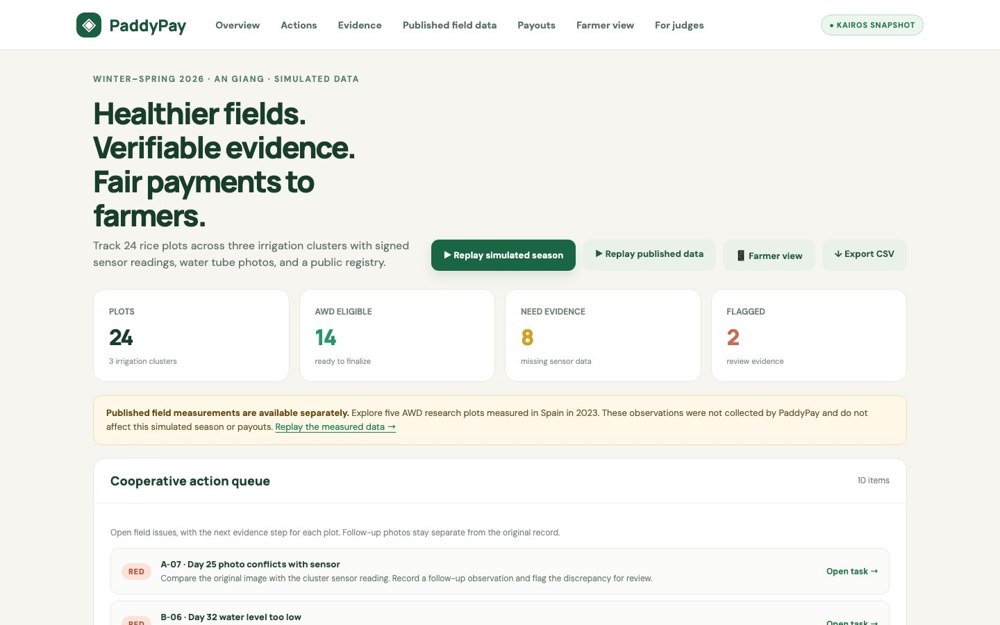
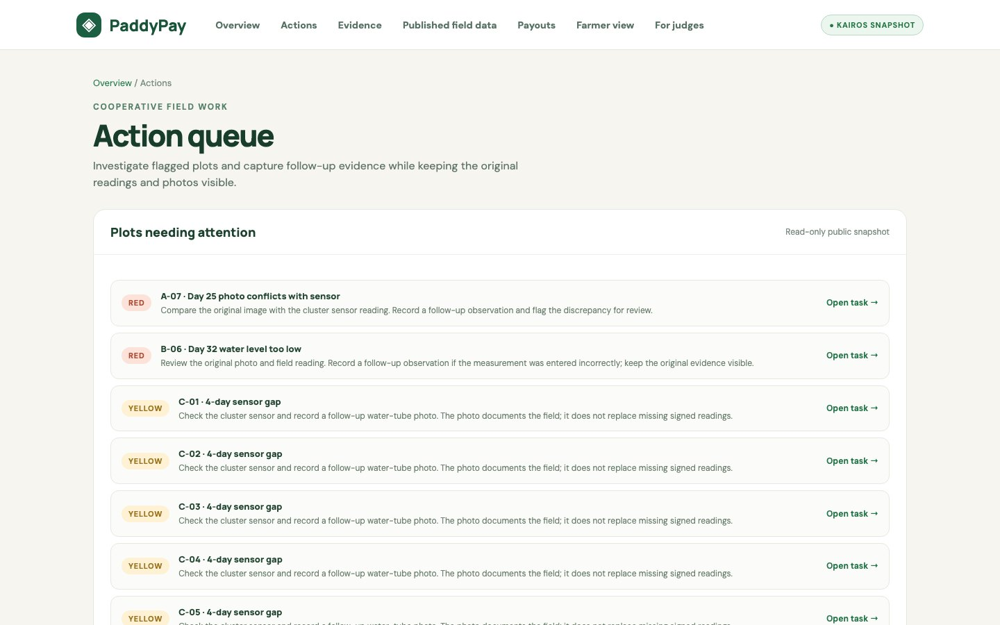
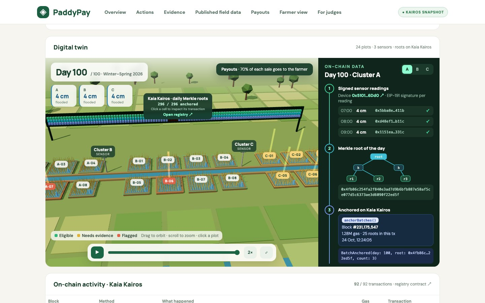
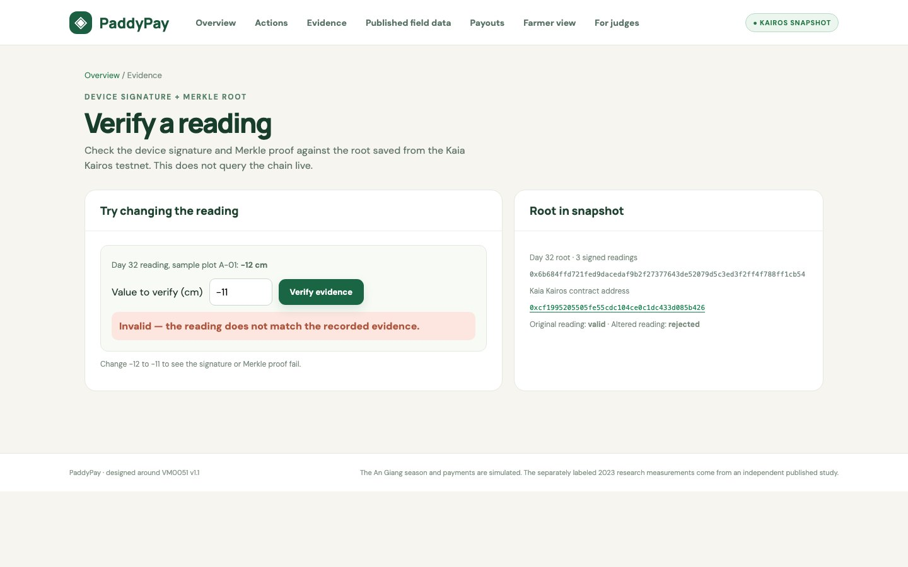
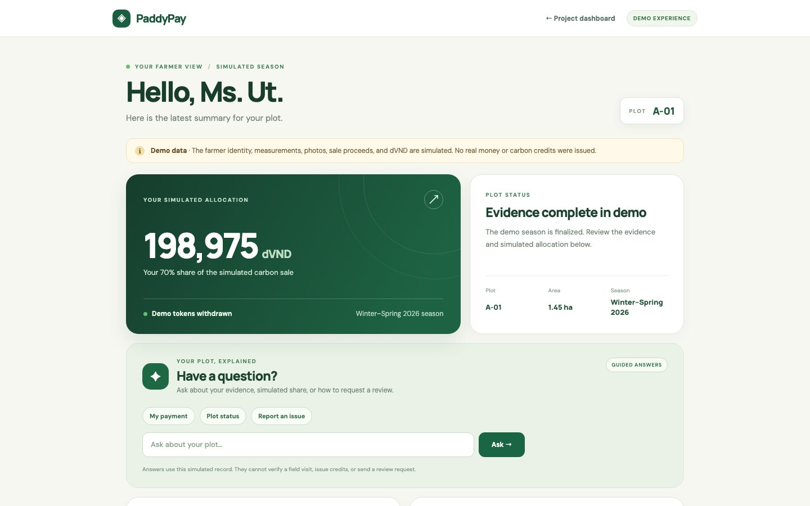
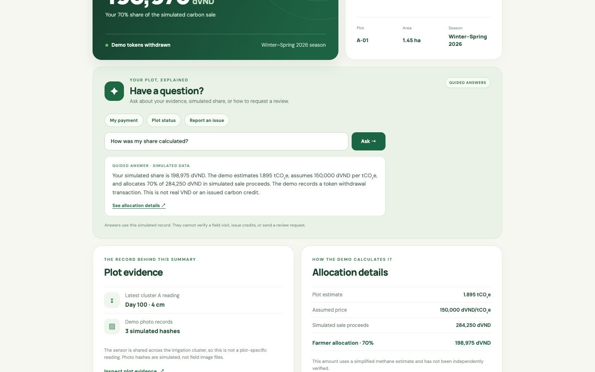
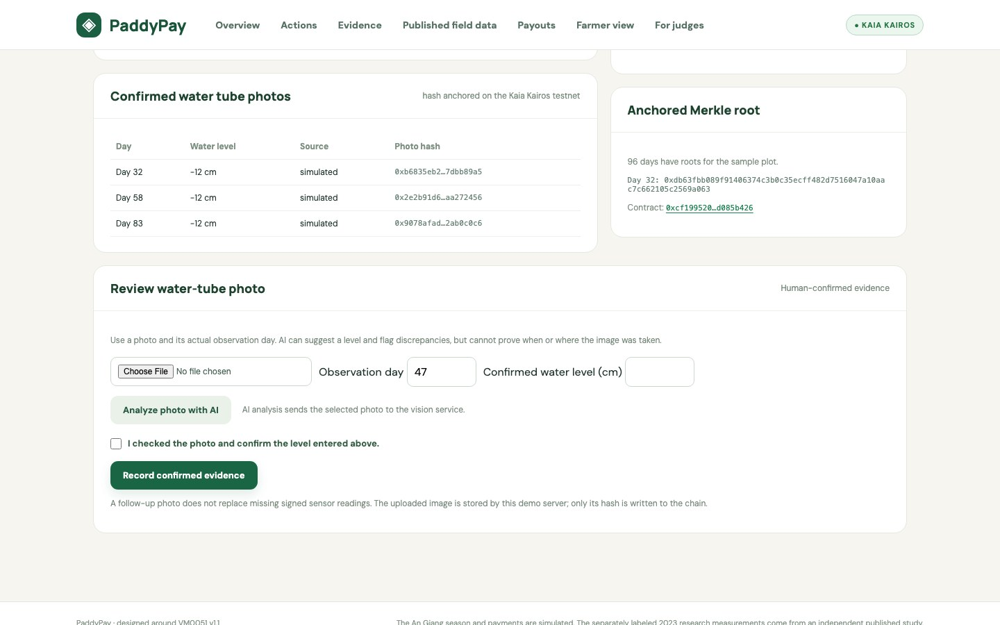
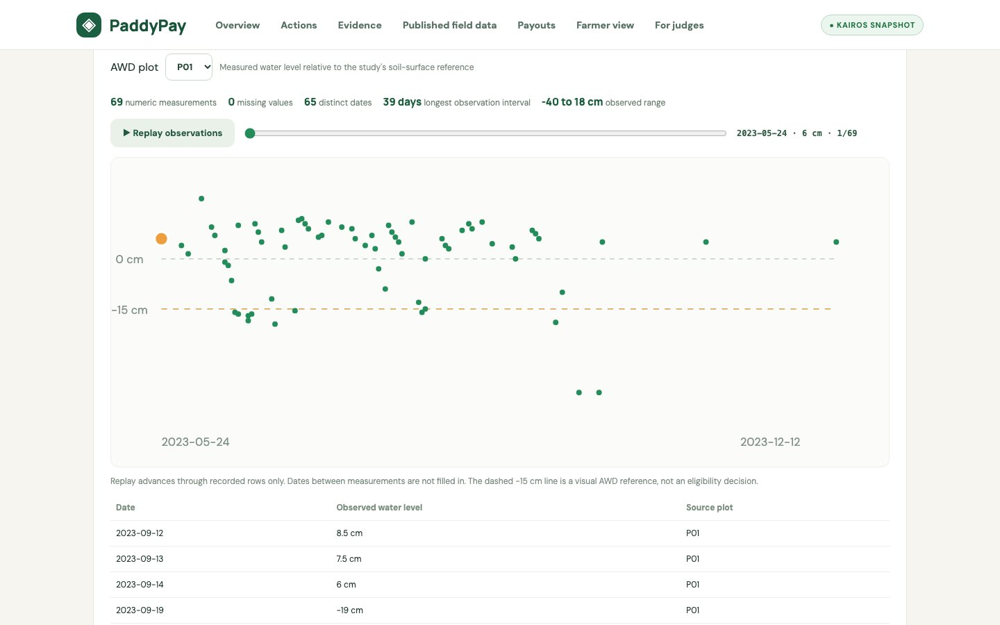

# PaddyPay

**Traceable carbon-credit evidence. Transparent rewards for rice farmers.**

PaddyPay is a working demo for documenting climate-smart rice farming and showing how the resulting carbon revenue could reach farmers. It combines water-level observations, field-photo evidence, plot assessments, blockchain records, and understandable farmer receipts in one workflow. Its starting point is **alternate wetting and drying (AWD)**: periodically allowing irrigated rice fields to dry to a safe threshold before reflooding. The International Rice Research Institute (IRRI) describes AWD as a way to reduce irrigation water use by about 30% and methane emissions by 30–70% under the conditions it discusses; those are research-level outcomes, **not measured PaddyPay results**. [IRRI][irri-awd]

## 1. Problem

Rice farming can be part of climate mitigation, but a credible carbon-credit claim requires much more than a statement that a farmer changed irrigation practices. A project must define its baseline, document what happened in the fields, quantify emissions using an applicable methodology, and pass independent validation and verification before credits can be issued. Verra's Verified Carbon Standard (VCS) describes these as separate stages: project design, validation, monitoring, verification, approval, and issuance. [Verra project lifecycle][verra-lifecycle]

For a smallholder rice program, that creates three practical problems:

1. **Evidence is fragmented.** Water readings, dates, plot identities, photos, and calculations must be linked to the same field and season. A missing sensor period or a photo that conflicts with a reading needs to remain visible rather than disappear inside a summary.
2. **Claims are hard to audit.** A verifier needs to trace an estimate back to the observations and assumptions that produced it. A farmer needs a simpler answer: *What happened on my plot, and why does the system say I qualify or need more evidence?*
3. **Revenue sharing can be opaque.** Even when a credit sale is eventually possible, farmers need a clear record of the sale price, allocation rule, amount assigned to them, and payment status. A carbon-credit registry's issuance record and a farmer's payment receipt solve different parts of this problem.

The need for better measurement, reporting, and verification (MRV) is concrete in Vietnam. The World Bank describes Vietnam's **One Million Hectares High-Quality, Low-Carbon Rice Program** in the Mekong Delta and identifies MRV systems and carbon-finance readiness as areas of work. The program's area is a policy target; it is **not** PaddyPay's customer base or a forecast of credits it could generate. [World Bank][world-bank]

## 2. Solution

PaddyPay follows a plot from field observation to a potential farmer payout:

1. **Collect and identify evidence.** The demo associates signed water-level readings and photo hashes with a plot, day, and season. A gateway rejects unknown devices and repeated or out-of-order readings. [Core implementation][core] · [Project overview][readme]
2. **Assess the plot.** Rule-based checks flag unsafe water levels, drainage at the wrong time, sensor gaps, missing photos, and conflicting evidence. The dashboard explains why a plot is green, yellow, or red and gives the cooperative an action queue. [Assessment rules][core] · [Action queue][action-queue]
3. **Preserve an audit trail.** The smart contract records evidence roots and photo hashes, checks signatures and Merkle proofs, and rejects a duplicate plot-and-season registration **within the same registry**. This makes changes to already-anchored evidence detectable; it does not prove that a physical sensor or photo was truthful at capture. [Registry contract][registry] · [Project overview][readme]
4. **Show the economics.** The app estimates methane-related CO₂e using a simplified formula, applies an assumed sale price, and displays a public **70% farmer / 10% cooperative / 20% developer** allocation. A mobile receipt explains the calculation without requiring the farmer to use a wallet. [Calculation and assumptions][core] · [Farmer view][farmer-view]

This is an **MRV and benefit-sharing demo**, not a carbon-credit issuer. Verra's current **VM0051 v1.1** methodology applies to improved water and crop management in flooded rice systems, but an actual project would still need to meet its full requirements and the VCS project lifecycle. [VM0051][verra-vm0051] · [Verra project lifecycle][verra-lifecycle]

## 3. Market

**Initial use case:** rice cooperatives and carbon-project developers coordinating AWD across many small plots in Vietnam's Mekong Delta. The cooperative would need day-to-day evidence collection and follow-up; a project developer would need organized records for project preparation and MRV; validators and verifiers would need a reviewable trail; farmers would need a comprehensible record of their own status and share. These are **proposed users and customers**, not signed customers or validated demand.

There is a relevant policy and methodology context. Vietnam is pursuing its one-million-hectare low-carbon rice program and exploring carbon finance, while Verra has an active rice methodology, VM0051 v1.1. Together, these indicate a potential need for reliable field-data and farmer-benefit workflows. They do **not** establish PaddyPay's total addressable market, guaranteed carbon-credit eligibility, or a guaranteed credit price. [World Bank][world-bank] · [VM0051][verra-vm0051]

PaddyPay's possible commercial path is software and implementation support for cooperatives or project developers: evidence collection, exception management, review exports, and transparent allocation records. Pricing, procurement, field operating costs, and willingness to pay remain to be tested with real partners. Carbon-credit buyers and auditors are important stakeholders, but PaddyPay does not currently sell credits.

## 4. Features

The screenshots below come from the hosted Kaia Kairos snapshot, except the AI photo screen, which was captured from the local app. The farmer question screenshot shows the hosted **guided-answer mode**; AI topic matching is available only on a local server configured with a working AI key.

### Plot and season dashboard

The dashboard presents a simulated **100-day Winter–Spring 2026 season** with **24 plots in three irrigation clusters**. The hosted snapshot shows **14 green, 8 yellow, and 2 red** assessments, with reasons for each status. [Snapshot][snapshot]

### Evidence checks and action queue

Signed readings, photo hashes, AWD timing and water-depth rules, gap detection, and conflict flags help the cooperative identify which plots need follow-up. The action queue keeps the original issue visible while showing the next evidence step. [Core rules][core] · [Action queue][action-queue]

### 3D season replay and public overview

The 3D view replays field conditions and plot status through the season alongside signed readings, Merkle roots, and testnet transaction details. A separate judge-facing page summarizes public evidence without listing farmer names or wallet addresses in the plot APIs. [Project overview][readme] · [Public API tests][vercel-test]

### On-chain audit trail

The contract records evidence roots and photo hashes, rejects duplicate registrations within its registry, allocates simulated proceeds, and supports one-time withdrawals. The screenshot shows that changing a **−12 cm** reading to **−11 cm** fails verification against the saved signature and Merkle proof. The public demo uses the **Kaia Kairos testnet**; Vercel serves a read-only snapshot of that run. [Registry contract][registry] · [Vercel API test][vercel-test]

### Farmer-facing receipt

The mobile-friendly view explains a household's plot status, estimated CO₂e, assumed sale price, allocation percentage, and simulated withdrawal transaction. The hosted version offers guided answers to common questions without requiring a wallet. [Farmer view][farmer-view] · [Project overview][readme]

### Farmer question assistant

Farmers can ask about their payment, plot status, field evidence, carbon estimate, AWD practice, or how to request a review. The screenshot shows a **real answer from the hosted guide**: it explains plot A-01's 70% share using the saved receipt and plot record. On a local server with a working AI key, AI classifies a free-text question into relevant topics; the server still writes the answer from recorded facts. Only the question is sent to the AI service, and the system falls back to the guide if the service fails. AI cannot change eligibility, invent a payment, or submit a review request. [Farmer assistant implementation][farmer-assist] · [Hosted endpoint][farmer-assist-api] · [Project overview][readme]

### Human-reviewed AI photo assistance

The screenshot shows the app's **real local review interface**. When a working AI key is configured, optional image review suggests a water-tube reading or abstains if the image is unclear, then flags conflicts with sensor data. A person must confirm the value before the photo hash is recorded. No genuine field photo or AI result is shown in this screenshot, and the workflow is **not available on the hosted Vercel snapshot**. [AI review][ai-review] · [Project overview][readme]

### Research-data ingestion test

A separate page replays published 2023 AWD observations from five plots in Spain while preserving their provenance and missing-data gaps. This is a software ingestion test, **not** a PaddyPay field pilot or a basis for payouts. [Research notes][readme] · [Source dataset][research-source]

The payout example makes the rule inspectable: for simulated plot **A-01**, the demo shows **1.895 tCO₂e** × **150,000 demo dVND/tCO₂e** = **284,250 demo dVND** in assumed sale proceeds; **70%** gives the farmer **198,975 demo dVND**. The price, token, sale, and payout are all simulated. [Calculation][core] · [Snapshot][snapshot]

## 5. Benefits

| Stakeholder | Intended benefit |
| --- | --- |
| **Farmers** | A plain-language explanation of plot status and the allocation calculation, with a receipt they can open without managing a wallet. |
| **Cooperatives** | Earlier visibility into missing or conflicting evidence and a queue of actions to take before a season is finalized. |
| **Project developers and reviewers** | A connected record from observations to plot decisions, hashes, transactions, and an exportable plot summary. |
| **Potential credit buyers** | A clearer route to inspect project evidence and benefit sharing **if** a future project is independently validated, verified, and issued credits under an applicable standard. |

These are **product benefits the system is designed to enable**. PaddyPay has not yet measured time savings, increased farmer income, real water savings, or actual methane reductions in a field deployment.

## 6. Vision

PaddyPay's long-term goal is to make rice-carbon programs both credible and farmer-centered: every claim should be traceable to field evidence, every uncertainty should be visible, and every farmer should be able to understand the money attributed to their work.

The next meaningful steps are a cooperative field pilot with real devices and authenticated farmer access; independently checked plot boundaries, baseline and monitoring data; stronger photo provenance and issue-resolution workflows; a full methodology-aligned emissions calculation, including relevant gases and uncertainty; and an independently validated and verified project before any carbon-credit issuance claim. Those steps follow the distinction Verra makes between monitoring data and issued VCUs. [VM0051][verra-vm0051] · [Verra project lifecycle][verra-lifecycle]

## 7. Current status and limits

- PaddyPay is a **hackathon demo**. Its seeded season, farmer identities, sensor readings, photo hashes, carbon sale, and dVND payments are simulated. The estimate is a simplified methane calculation, **not** a verified VM0051 result. [Project overview][readme] · [Core assumptions][core]
- The public site is a **read-only Vercel snapshot** of a Kaia Kairos testnet run. It can check a saved signature and Merkle proof against a saved root; it is not a live connection to the registry contract for every request. [Vercel API test][vercel-test] · [Project overview][readme]
- No verified carbon credits have been issued by PaddyPay, and no real VND payment has been made. Under VCS, credit issuance follows project registration, monitoring, independent verification, and Verra approval. [Project overview][readme] · [Verra project lifecycle][verra-lifecycle]
- A hash or blockchain transaction protects the integrity of a recorded item; it does **not** independently establish that a field photo is genuine, geolocated correctly, or taken on the claimed date. Duplicate protection in the current registry covers entries in its own registry, not all outside carbon programs. [Registry contract][registry] · [Project overview][readme]

## 8. Sources and evidence

**External sources**

- [IRRI — Alternate Wetting and Drying][irri-awd]: AWD practice and the water-use and methane-reduction ranges cited above.
- [World Bank — Low-carbon rice farming in Viet Nam][world-bank]: Vietnam's one-million-hectare program, MRV work, and carbon-finance context.
- [Verra — VM0051 Improved Management in Rice Production Systems, v1.1][verra-vm0051]: active rice-project methodology.
- [Verra — Develop a VCS Project][verra-lifecycle]: validation, monitoring, verification, approval, and credit issuance stages.
- [Published research source dataset][research-source]: provenance for the separate research ingestion test.

**Project evidence**

- [README][readme], [core simulation and calculation][core], [action queue][action-queue], [registry contract][registry], [hosted snapshot][snapshot], and [public API tests][vercel-test].

External sources were checked on **24 October 2026**. Market-fit statements and future capabilities above are proposals; current demo behaviors are tied to the linked repository files.

[irri-awd]: https://ghgmitigation.irri.org/mitigation-technologies/alternate-wetting-and-drying
[world-bank]: https://www.worldbank.org/en/news/feature/2025/05/20/kwpf-grant-supports-low-carbon-rice-farming-in-viet-nam
[verra-vm0051]: https://verra.org/methodologies/vm0051-improved-management-in-rice-production-systems-v1-1/
[verra-lifecycle]: https://verra.org/programs/verified-carbon-standard/develop-a-vcs-project/
[research-source]: https://github.com/echeverriaseba/Thesis_Paper_3/blob/7af258ac87b937d85a3b4b81c166736e9cbd3377/data/2023/Piezo_2023.csv
[readme]: README.md
[core]: src/core.js
[action-queue]: src/action-queue.js
[registry]: contracts/src/PaddyRegistry.sol
[snapshot]: deployment/snapshot.json
[vercel-test]: test/vercel.test.js
[farmer-view]: public/farmer.html
[farmer-assist]: src/farmer-assist.js
[farmer-assist-api]: api/farmer-assist.js
[ai-review]: src/ai-review.js
